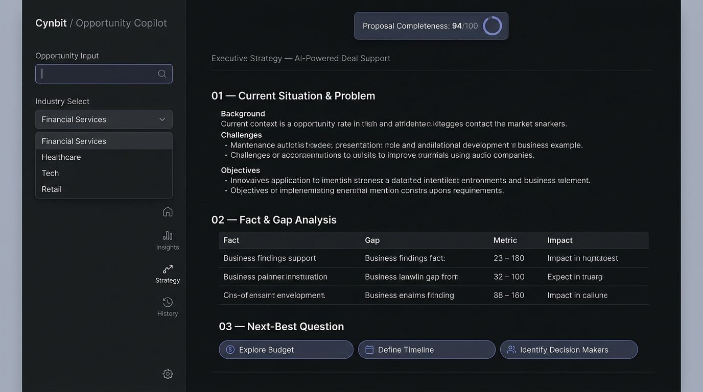

# Cynbit AI Opportunity Copilot — LangGraph Edition

A LangGraph-powered AI opportunity copilot proof of concept that transforms unstructured client briefs into structured, reviewable technical solution proposals with explicit fact classification, schema validation, provider fallback, and human-in-the-loop review.

---

## Workspace Preview & Demonstration



### 10-Second Workflow Demonstration
1. **Paste Messy Brief**: Input raw client notes, customer discovery transcripts, or RFP requirements.
2. **Analyze & Classify**: Generates a scoped blueprint with 3-tier fact classification (`[KNOWN]`, `[INFERRED]`, `[MISSING]`).
3. **Apply Next-Best Question**: Click a prioritized option pill to resolve ambiguity; 1-click refinement injects the clarification into the brief and recalculates the proposal immediately.
4. **Target Architecture & Phasing**: Reviews the minimal pipeline flow (`Ingestion ➔ Validation ➔ Gate ➔ Grounded LLM ➔ Human Queue ➔ Target`) and phased implementation milestones.
5. **Governance & Export**: Audits feasibility and compliance, reviews the **Proposal Completeness Score**, and exports to Markdown (`.md`) or JSON.

---

## Editorial Consulting Workspace

1. **Quiet Collapsible Sidebar (Left Panel)**
   - **Breadcrumb & Brand**: `Cynbit / Opportunity Copilot` · Solution Architect Workspace.
   - **Client Brief Intake**: Raw client notes, meeting transcripts, or RFP snippets with character counter (bounded to 15,000 chars).
   - **Load Sample Button**: Instant demonstration with B2B lead triage brief.
   - **Workspace Controls**: Industry, Primary Business Objective, Operational Constraints.
   - **AI Engine Selector & Telemetry**: Dynamic live provider detection (Groq `openai/gpt-oss-120b`, Gemini `gemini-3.8-flash`, or deterministic baseline).

2. **Main Proposal Document Canvas (Center Editorial Sheet)**
   - **Header & Versioning**: Version 1.0, solution category breadcrumbs, Markdown/JSON/clipboard export actions.
   - **`01 — Current Situation & Problem`**: Executive problem narrative describing client context and existing manual bottlenecks.
   - **`02 — Fact & Gap Analysis`**: Three clean categorized sections:
     - `[KNOWN] Stated in Brief`: Explicit constraints directly from the client.
     - `[INFERRED] Architectural Deductions`: Derived latency boundaries, validation patterns, and technical assumptions.
     - `[MISSING] Unanswered Questions & Blind Spots`: Critical unstated volumes, integration unknowns, and schema blind spots.
   - **`03 — Next-Best Question Callout`**: Interactive decision block with selectable option pills and 1-click refinement that injects the clarification into the brief and recalculates the proposal immediately.
   - **`04 — Recommended Approach & Target Architecture`**: Strategy narrative, minimal horizontal pipeline strip, and numbered step-by-step technical execution steps.
   - **`05 — Phased Implementation & Success Criteria`**: Phase-by-phase delivery milestones, measurable acceptance metrics, and ground-truth data requirements.
   - **`06 — Governance, Risks & Review Council`**:
     - **Proposal Completeness Score**: Structural coverage score (0–100/100).
       > *Based on requirements coverage, architecture completeness, unresolved critical questions, and governance checks. Avoids implying business outcome has been validated.*
     - **3 Evidence-Based Review Audits**:
       - 🛠 **Technical Feasibility**: `PASS` if deterministic validation rules and human review gates are explicit in the workflow; `REVIEW` if gating schematics are unverified.
       - 🔒 **Security & Data Risks**: `REVIEW` — Audits external LLM transmission against confidential data constraints and vendor Zero Data Retention (ZDR) requirements (avoids claiming unverified PII sanitization).
       - 💰 **Business Value & Scope**: `NOT ASSESSED` when brief lacks quantitative volume/cost baselines; `REVIEW` when initial metrics require client verification.
     - **Identified Operational Risks**: Concise risk catalog.

---

## Technical Interview & Code Walkthrough Guide

### "Why LangGraph instead of a single prompt?"
> *"The task naturally has multiple stages—intake, fact extraction, solution planning, and governance review. LangGraph lets me model those as explicit state transitions instead of one large prompt, which makes the workflow easier to validate, extend with conditional routing, and fall back safely when an LLM fails."*

### Key Functions Walkthrough (2-Minute Summary)
1. **`intake_node(state)`** — Validates and normalizes the input, enforcing length bounds (15,000 chars) to prevent payload abuse.
2. **`opportunity_mapping_node(state)`** — Classifies the opportunity pattern (e.g. Document Intelligence, Lead Triage, Predictive Analytics) and establishes the deterministic baseline.
3. **`technical_plan_node(state)`** — Dispatches to the active provider (Groq `openai/gpt-oss-120b`, Gemini `gemini-3.8-flash`, OpenAI) with strict schema validation (`validate_proposal_schema`), safely falling back on syntax or network failures.
4. **`review_node(state)`** — Computes evidence-based review audits (`PASS`, `REVIEW`, `NOT ASSESSED`) and safe defaults.
5. **`compute_completeness_assessment(analysis)`** — Calculates the 0–100 Proposal Completeness Score across requirements coverage, architectural phasing, blind spots, and operational risks.

---

## Project Structure

```
cynbit_ai_opportunity_copilot_langgraph/
├── copilot_graph.py      # Core LangGraph state machine & multi-provider LLM caller
├── server.py             # FastAPI backend exposing REST API and serving web UI
├── static/
│   ├── index.html        # Editorial consulting layout (Sidebar + Proposal Canvas)
│   ├── style.css         # Single-accent restrained SaaS stylesheet (Slate & Indigo)
│   └── app.js            # Client-side state, Next-Best-Question, & exports
├── tests/
│   └── test_copilot.py   # Automated unit tests (13 test cases covering fallback, schema, etc.)
├── docs/
│   └── demo_preview.png  # UI preview asset
├── app.py                # Legacy Streamlit UI (fallback)
├── requirements.txt      # Python dependencies (includes pytest, pydantic, httpx)
├── .env.example          # Sample environment variables
└── README.md             # Project documentation
```

---

## Quickstart & Running Locally

### 1. Prerequisites & Virtual Environment
```bash
# Create and activate virtual environment
python3 -m venv .venv
source .venv/bin/activate        # macOS/Linux
# .venv\Scripts\activate         # Windows

# Install dependencies
pip install -r requirements.txt
```

### 2. Configure Environment Variables
Create a `.env` file in the root directory (copied from `.env.example`):
```bash
# Groq API (Flagship 2026 production models with sub-2s latency)
GROQ_API_KEY="gsk_..."
GROQ_MODEL="openai/gpt-oss-120b"

# Google Gemini (Google AI Studio)
GEMINI_API_KEY="AIzaSy..."
GEMINI_MODEL="gemini-3.8-flash"

# OpenAI (Optional)
OPENAI_API_KEY="sk-..."
OPENAI_MODEL="gpt-4o-mini"
```
*(Note: If no API keys are provided, the system runs automatically with a deterministic baseline engine and explicitly labels the output as rule-based).*

### 3. Launch Application
```bash
# Start the focused FastAPI web app (Recommended):
python server.py

# Or on a custom port:
PORT=8501 python server.py
```
Open **[http://localhost:8501](http://localhost:8501)** in your browser.

*(To run the legacy Streamlit interface instead: `streamlit run app.py`).*

---

## Running Automated Unit Tests

A comprehensive unit test suite validates classification, schema integrity, provider fallback, size limits, and REST endpoints:

```bash
.venv/bin/pytest tests/test_copilot.py -v
```

**13 Passing Unit Tests**:
- `test_deterministic_baseline_execution`: Verifies fallback works without keys and labels mode as rule-based.
- `test_fact_classification_triad`: Validates `[KNOWN]`, `[INFERRED]`, and `[MISSING]` arrays.
- `test_next_best_question_contract`: Verifies question text, options list, and impact description.
- `test_completeness_assessment_logic`: Verifies 4-check scoring logic (0–100 pts) with transparent breakdown.
- `test_evidence_based_review_verdicts`: Verifies dynamic statuses (`PASS`, `REVIEW`, `NOT ASSESSED`) based on input evidence.
- `test_schema_validation_accepts_valid_payload`: Tests strict dictionary schema validator.
- `test_schema_validation_rejects_malformed_model_output`: Verifies rejection of incomplete LLM JSON responses.
- `test_provider_failure_graceful_fallback`: Tests automatic fallback when an unrecognized provider is requested.
- `test_provider_exception_triggers_fallback`: Tests simulated runtime API/network failure recovery.
- `test_api_status_endpoint`: Tests `/api/status` health and provider availability.
- `test_api_analyze_endpoint`: Tests `/api/analyze` end-to-end proposal generation.
- `test_api_analyze_empty_brief_validation`: Tests 400 rejection for empty briefs.
- `test_api_analyze_request_size_limit`: Tests request bounding for briefs > 15,000 characters.

---

## API Endpoints Reference

| Method | Endpoint | Description |
| :--- | :--- | :--- |
| `GET` | `/` | Serves the editorial consulting workspace. |
| `GET` | `/api/status` | Returns active LLM provider telemetry and model status. |
| `GET` | `/api/samples` | Returns sample discovery briefs for instant demonstration. |
| `POST` | `/api/analyze` | Invokes the LangGraph graph with `{ brief, industry, objective, constraints, provider }`. |

---

## Pre-Submission GitHub Checklist

- [x] Remove `.env` (strictly git-ignored; kept `.env.example` only)
- [x] Remove `.venv` from repo
- [x] Remove `.pytest_cache`
- [x] Add UI screenshot/preview to README (`docs/demo_preview.png`)
- [x] Push clean commit history with defensible documentation
